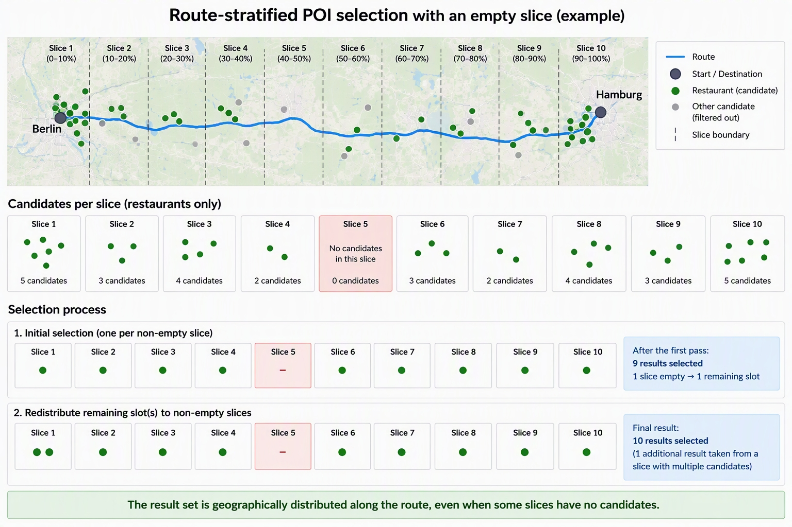

# Search Along the Route

The widget supports searching for places along a road corridor, optionally
reranking results by actual driving time using the HERE Routing API.
This page explains how to set up a route, choose a ranking mode, and read
the result button titles.

For a hands-on, code-level walkthrough of the same feature, see the notebooks
[RouteEngine](../tutorials/route/high-level/ch_hl_route_1_engine.md),
[DetourRanker](../tutorials/route/high-level/ch_hl_route_2_detour.md) and
[Detour Map](../tutorials/route/high-level/ch_hl_route_3_render.md) pages.

To add the same feature to an application built on its own route, ranking and map classes,
see [Routing Client](../tutorials/route/ch_route_1_api.md),
[Detour Re-ranking](../tutorials/route/ch_route_4_detour.md) and
[Detours Rendering](../tutorials/route/ch_route_5_render.md), which build it on
the `RoutingAPI` client alone, plus
[Polyline Simplification](../tutorials/route/ch_route_2_simplify.md) and
[Ahead On The Route](../tutorials/route/ch_route_3_ahead.md) for the corridor
polyline budget and the *minutes from position* setting.

---

## Setting up a route

Long-press anywhere on the map to open the route pop-up.  Use the drop-down
to assign the role of each tap:

| Action | Effect |
|--------|--------|
| **route start** | Sets the route origin |
| **route stop** | Sets the route destination |
| **pos on route** | Sets your current position on the route (`at`) |
| **remove route** | Clears all route data and returns to normal search |

Once both **start** and **stop** are set the app calls the HERE Routing API,
draws the road corridor on the map, and encodes it as a
[Flexible Polyline](https://github.com/heremaps/flexible-polyline) that is
appended to every subsequent search request.

### width

The **width** text field (in metres) controls the half-width of the search
corridor.  Changing the value re-draws the corridor immediately; the new
width takes effect on the next search submission.

For the exact simplification equations, see the
[Route math appendix](../reference/route_math.md) or its
[code counterpart](../reference/route_code.md).

### min from pos

The **min from pos** text field shifts the search centre forward along the
route by the given number of minutes of driving time from the **pos on route**
anchor.

In plain terms, the app first figures out how long into the trip your selected
**pos on route** point is by adding the durations of all route spans before the
span where your car would be. For that current span, it adds only a proportional
part of the span duration (based on how far through that span you are), then
adds the minutes you entered and finds the matching point further ahead on the
same route as the new search centre.

| Field value | Search centre used |
|-------------|--------------------|
| *(empty)* | The exact **pos on route** position |
| `N` | The point N driving-minutes ahead of **pos on route** along the route |

**How it works:**

1. When the user sets **pos on route** that position is saved as the
   *origin anchor* (`_origin_at_position`).
2. Entering a number in **min from pos** computes the elapsed driving time
   from the route start to the origin anchor (by walking the span data
   returned by the Routing API), adds `N × 60` seconds, then interpolates
   the exact geographic position at that new elapsed time along the polyline.
3. The `at` marker on the map moves to that future position, which becomes
   the search centre for all subsequent queries.
4. Changing the value always re-computes from the same origin anchor, so
   you can freely adjust N without sliding further and further along the
   route.  Only moving **pos on route** resets the anchor.
5. When a new route is drawn any active **min from pos** offset is
   automatically reapplied.

For how the anchor time and the future position are computed, see the
[Route math appendix](../reference/route_math.md) or its
[code counterpart](../reference/route_code.md).

> **Example:** You are at kilometre 0 of your route.  You set **pos on route**
> there and type `45` in **min from pos**.  The search centre jumps to the
> point you will reach in 45 minutes, and the search corridor is trimmed to
> start from that future position.

> **Note:** `with=recommendPlaces` is automatically disabled whenever a route
> is active because the two features are mutually exclusive in the Search API.
> The 100-result backend limit that `recommendPlaces` requires is therefore
> also not requested.

---

## Ranking modes

Two checkboxes refine how results are ordered.  They are independent and can
be combined.

### All along

| State | Search API parameter | Effect |
|-------|---------------------|--------|
| ☐ off | *(none)* | Default relevance ranking |
| ☑ on  | `ranking=excursionDistance` | Server pre-sorts results by excursion distance from the corridor |

When **all along** is on the Search API itself ranks results by how far out
of the way they are, cheaply and without extra network calls.

#### Spreading results across the whole remaining route

A single `ranking=excursionDistance` call can still bunch every result near
one end of a long trip, since real-world place density is rarely uniform
along a route. Whenever the **remaining** route — from your current position
to the destination, not the full start-to-stop route — is long enough
relative to the number of requested results (more than 1&nbsp;km of
remaining route per result), the app instead splits that remaining route
into up to 20 equal-length slices, searches each slice's corridor in
parallel, and merges the results: one pick per slice first, then any slice
that came back empty has its slot redistributed to whichever other slice has
the next-best backup candidate.



In the example above, slice 5 returned no restaurants. Its slot is handed to
a slice that returned more than one candidate, so the final 10 results still
spread across the whole Berlin → Hamburg corridor instead of clustering near
one end.

For short remaining routes, or when there is no route at all, this is a
no-op: exactly one corridor search is made, same as before. For the exact
threshold and the redistribution algorithm, see the
[Route math appendix](../reference/route_math.md) or its
[code counterpart](../reference/route_code.md).

### Travel time

| State | Client post-processing | Sort key |
|-------|------------------------|----------|
| ☐ off | *(none)* | Order returned by the Search API |
| ☑ on  | Calls Routing API once per result | See table below |

When **travel time** is on the app calls the HERE Routing API for each result
using a single route with a via waypoint: `at → via(result) → stop`. This
efficiently computes both legs (`at → result` and `result → stop`) in one call.
An additional baseline route `at → stop` is computed to calculate excursion
distances. All routing calls are made in parallel using `asyncio.gather`.

Results are then reranked client-side by travel time and optionally filtered
by maximum excursion distance.

The sort key depends on **all along**:

| all along | Sort key |
|-----------|----------|
| ☐ off | `dur_to` — minimise time to *reach* the result from your current position |
| ☑ on  | `dur_to + dur_from` — minimise total round-trip time back to your destination |

For the reranking rules, see the
[Route math appendix](../reference/route_math.md) or its
[code counterpart](../reference/route_code.md).

#### Implementation details

The routing API call for each result includes the street address as a `nameHint`
parameter when available (e.g., `via=52.47,13.37;nameHint=Main Street`), which
helps the routing engine disambiguate locations near complex intersections.

---

## Result button titles

When **travel time** is active each result button title is annotated:

```
<place name> (<dur_to>min, <dur_from>min, <sign><detour_km>km)
```

| Field | Meaning |
|-------|---------|
| `<dur_to>min` | Driving time in minutes from your `at` position to the result |
| `<dur_from>min` | Driving time in minutes from the result to the route destination |
| `<sign><detour_km>km` | Extra kilometres added to (or saved from) the `at → stop` direct route |

The detour sign is computed relative to the **direct** `at → stop` distance, not
the full route from its origin:

* **`+N km`** — the detour adds N km to your remaining journey
* **`-N km`** — the route through this result is shorter than the direct path;
  the routing engine found an optimized path `at → result → stop`

### Example

```
Burger King (3min, 12min, +2km)
```

Means: 3 minutes to drive there, 12 minutes onward to your destination, and
the stop adds 2 km to the remaining journey.

```
Shell (1min, 8min, -1km)
```

Means: the fuel station is practically on your direct path — stopping there
actually saves 1 km compared to the straight `at → stop` route.

---

## Combining ranking modes

| all along | travel time | Behaviour |
|-----------|-------------|-----------|
| ☐ | ☐ | Default relevance — fastest, no extra API calls |
| ☑ | ☐ | Server excursion ranking — one search call, results pre-sorted by corridor proximity |
| ☐ | ☑ | Client travel-time ranking by `dur_to` — one Routing API call per result, sorted by time to reach |
| ☑ | ☑ | Server pre-sort + client reranking by `dur_to + dur_from` — best quality, optimal routing efficiency |

---

For map-rendering details (label collision + fit-bounds zoom), see the
[Map math appendix](../reference/map_math.md) or its
[code counterpart](../reference/map_code.md).
